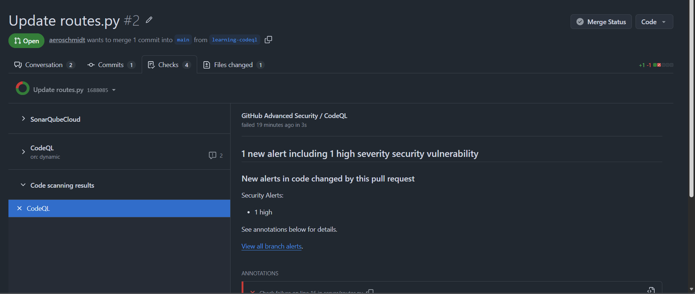
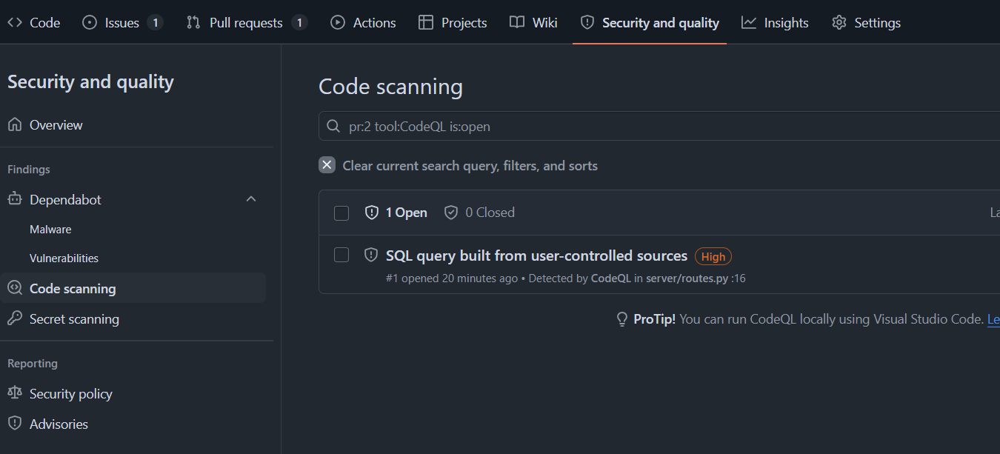
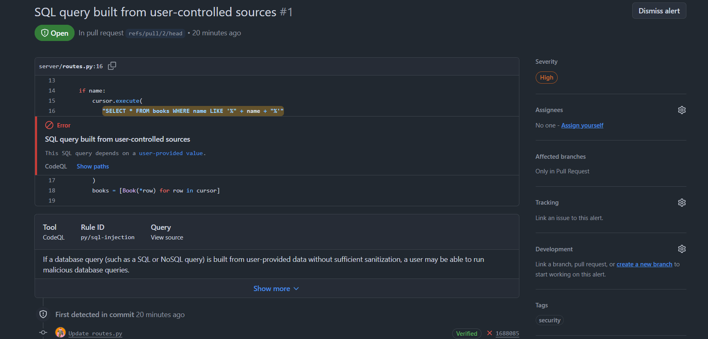
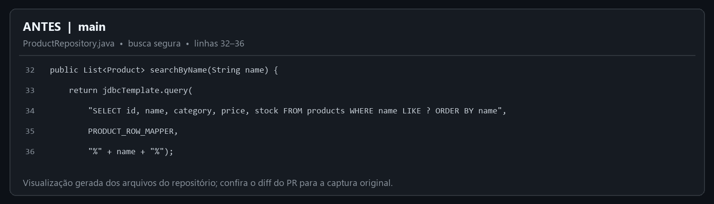
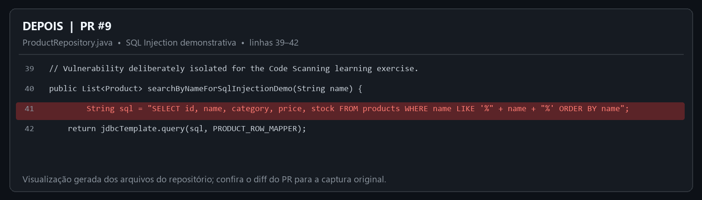
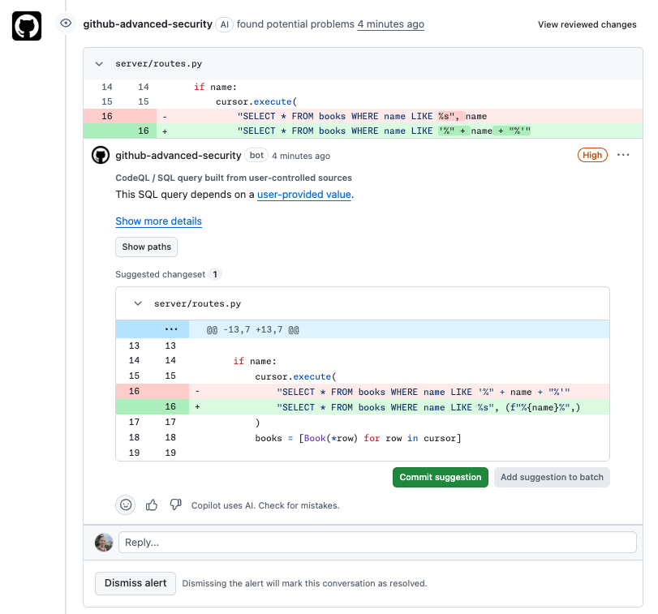
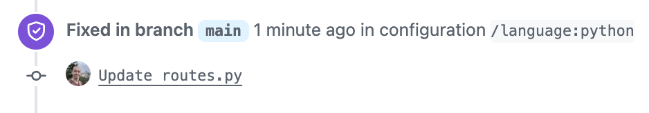
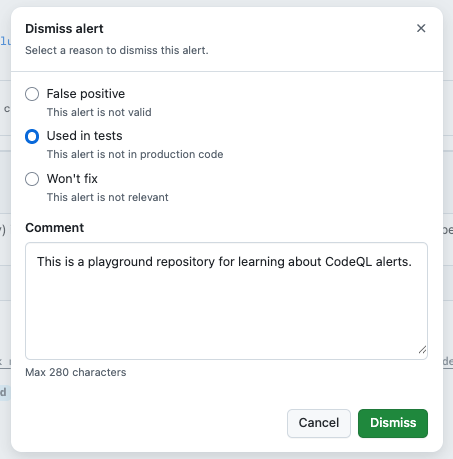
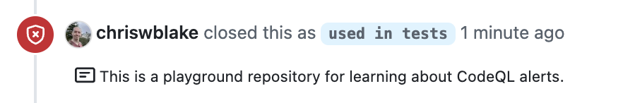

GITHUB SECURITY  /  PULL REQUESTS

# Guia de Code Scanning para usuários

Como investigar, corrigir e confirmar um alerta no seu [Pull Request](https://docs.github.com/en/pull-requests/get-started/about-pull-requests) (PR)

Use este guia ao receber um alerta de Code Scanning em um Pull Request. Investigue e corrija; consulte o final para exceções e Dismiss.

> **Fluxo recomendado**
> Aguarde a análise → abra o alerta → confira regra, severidade e trecho → corrija → envie um commit → confirme a nova análise.

## Resolva o alerta no PR

1. Aguarde a análise. Na aba [Checks](https://docs.github.com/en/pull-requests/reference/status-checks), abra [Code scanning results](https://docs.github.com/en/code-security/how-tos/manage-security-alerts/manage-code-scanning-alerts/triage-alerts-in-pull-requests).

1. Abra a anotação no PR ou em Security and quality → Code scanning. Ela aparece quando o alerta novo atinge linhas do diff.

1. Leia regra, severidade, arquivo e linha; confira o código e o [diff](https://docs.github.com/en/code-security/how-tos/manage-security-alerts/manage-code-scanning-alerts/triage-alerts-in-pull-requests). Se houver [Show paths](https://docs.github.com/en/code-security/concepts/code-scanning/code-scanning-alerts), siga o fluxo até o uso.

1. Confirme o achado; se houver dúvida, consulte o revisor ou a equipe de segurança. Se não puder corrigir neste PR, não use Dismiss para liberar: mantenha o alerta aberto e combine o encaminhamento.

1. Se confirmado, corrija a causa, ajuste testes se necessário e envie um commit na [branch](https://docs.github.com/en/pull-requests/reference/branches) do PR.

1. Após a nova análise, confirme [Fixed](https://docs.github.com/en/code-security/how-tos/manage-security-alerts/manage-code-scanning-alerts/resolve-alerts) e que compilação/testes do GitHub Actions passaram. Sem alerta novo não prova ausência de vulnerabilidades: confira arquivos e linguagens cobertos. O [merge](https://docs.github.com/en/pull-requests/get-started/about-pull-requests) segue as regras do repositório.

Exemplo histórico de um PR de treinamento com check do CodeQL e alerta High. Não é um PR de produção.

> **Importante**
> Compilação/testes do [GitHub Actions](https://docs.github.com/en/pull-requests/reference/status-checks) e alertas do [Code Scanning](https://docs.github.com/en/code-security/concepts/code-scanning/code-scanning-alerts) são resultados distintos. O primeiro pode passar mesmo com alertas; o [merge](https://docs.github.com/en/pull-requests/get-started/about-pull-requests) depende das [regras do repositório](https://docs.github.com/en/repositories/configuring-branches-and-merges-in-your-repository/managing-protected-branches/about-protected-branches).

## Entenda o que o alerta aponta

A lista Code scanning mostra alertas abertos. No detalhe, confira regra, severidade, localização e, se disponível, fluxo de dados. A severidade orienta a prioridade; avalie o contexto.

Lista de alertas do exercício: selecione o achado para abrir seus detalhes.

Detalhe do alerta: regra, severidade e localização da linha destacada.

## Exemplo visual de uma vulnerabilidade

As imagens mostram um exercício isolado de CodeQL: uma consulta SQL parametrizada e segura e outra com concatenação insegura, que gera um alerta. Não copie o código vulnerável para sistemas reais.

ANTES — parâmetros separam a instrução SQL dos dados.

DEPOIS — a concatenação da entrada cria o cenário vulnerável do exercício.

O diff do PR mostra a alteração e a anotação do CodeQL no trecho detectado.

## Confirme a correção

Após corrigir, aguarde a análise e reabra o alerta. [Fixed](https://docs.github.com/en/code-security/how-tos/manage-security-alerts/manage-code-scanning-alerts/resolve-alerts) indica que a nova análise confirmou a correção no [branch](https://docs.github.com/en/pull-requests/reference/branches) examinado. Confira também o [diff](https://docs.github.com/en/code-security/how-tos/manage-security-alerts/manage-code-scanning-alerts/triage-alerts-in-pull-requests) e os testes.

Exemplo de timeline depois que a análise reconhece a correção como Fixed.

> **Fixed é diferente de Dismiss**
> Fixed confirma uma alteração que remove o problema. Dismiss encerra o alerta sem corrigir o código; veja a seção de referência ao final.

## Referência complementar

### Se não for possível corrigir: use Dismiss com responsabilidade

Use [Dismiss](https://docs.github.com/en/code-security/how-tos/manage-security-alerts/manage-code-scanning-alerts/resolve-alerts) somente após confirmar que o alerta não exige correção, como num falso positivo confirmado, código de teste ou risco aceito pela equipe. Siga a política do repositório e peça triagem em caso de dúvida.

1. Revise descrição, severidade, localização, diff e fluxo de dados.

1. Clique em Dismiss alert e escolha o motivo correspondente à análise.

1. Registre evidências, revisor, se a decisão é temporária ou permanente e o acompanhamento combinado.

1. Confirme o Dismiss e verifique o alerta em Closed, com motivo e comentário na timeline.

> **Permissão e aprovação**
> A opção de Dismiss normalmente exige permissão de escrita. A organização pode também exigir [aprovação delegada](https://docs.github.com/en/code-security/concepts/security-at-scale/delegated-alert-dismissal). Se a tela pedir aprovação, registre a justificativa e aguarde a pessoa autorizada.

A tela pede um motivo; o comentário registra o contexto da decisão.

Exemplo do evento de Dismiss registrado na timeline do alerta.

### O que Dismiss faz — e o que não faz

- Fecha o alerta em todos os branches e o move para Closed; é possível reabri-lo.

- Remove o item da contagem atual de alertas abertos e registra o motivo escolhido.

- O comentário é opcional na interface, mas recomendado para auditoria e revisão futura.

- Na próxima análise, o mesmo código não gera o mesmo alerta; o motivo pode afetar futuras execuções da regra.

- Não altera o código, não elimina o risco e não libera o merge por si só.

### Modelo de comentário para Dismiss

> **Adapte ao caso real**
> Revisor e data: [pessoa/equipe], [data]. Motivo: [motivo]. Evidência: [contexto]. Decisão: [temporária/permanente]. Acompanhamento: [ação e responsável]. Prazo ou data de revisão (se aplicável): [data].

### Dicas rápidas

| O que aparece | Como interpretar | O que fazer |
| --- | --- | --- |
| Verificação em andamento | Análise ainda não terminou. | Aguarde antes de tirar conclusões. |
| Alerta novo no diff | Achado em linha alterada no PR. | Abra detalhes e investigue. |
| GitHub Actions: compilação/testes falharam | A compilação do projeto falhou ou um teste não passou. | Abra a execução e leia o log. |
| Verificação do Code Scanning falhou | Pode ser falha na análise ou uma regra configurada para bloquear determinados alertas. | Leia o resumo e abra os detalhes da análise. |
| Nenhum alerta novo | A análise não reportou novo achado no escopo executado. | Confirme que rodou e cobriu o código/linguagem. |
| Fechado (Closed) | Alerta corrigido ou dispensado. | Confira a timeline para distinguir Fixed de Dismiss. |

### Checklist antes de aprovar ou pedir merge

☐  Verificações concluídas; alertas separados de falhas de compilação/testes do GitHub Actions.

☐  Cada alerta novo foi investigado no contexto do diff.

☐  Achados válidos foram corrigidos e reanalisados.

☐  Dismiss tem motivo e evidência; aprovação exigida foi obtida.

☐  A revisão humana do PR segue a política do repositório.

### Referências oficiais

[Triagem de alertas em Pull Requests](https://docs.github.com/en/code-security/how-tos/manage-security-alerts/manage-code-scanning-alerts/triage-alerts-in-pull-requests)

[Resolver alertas de Code Scanning](https://docs.github.com/en/code-security/how-tos/manage-security-alerts/manage-code-scanning-alerts/resolve-alerts)

[Sobre alertas de Code Scanning](https://docs.github.com/en/code-security/concepts/code-scanning/code-scanning-alerts)

[Dismiss delegado de alertas](https://docs.github.com/en/code-security/concepts/security-at-scale/delegated-alert-dismissal)

Capturas de treinamento; interface e políticas variam conforme ferramenta e repositório. Documentação oficial consultada em 12 de outubro de 2026.
