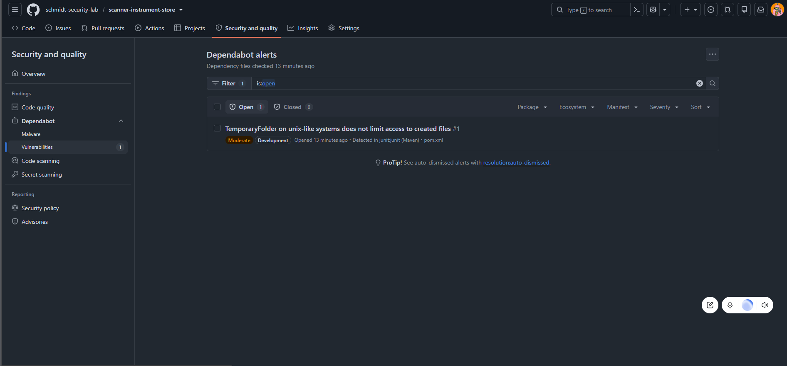
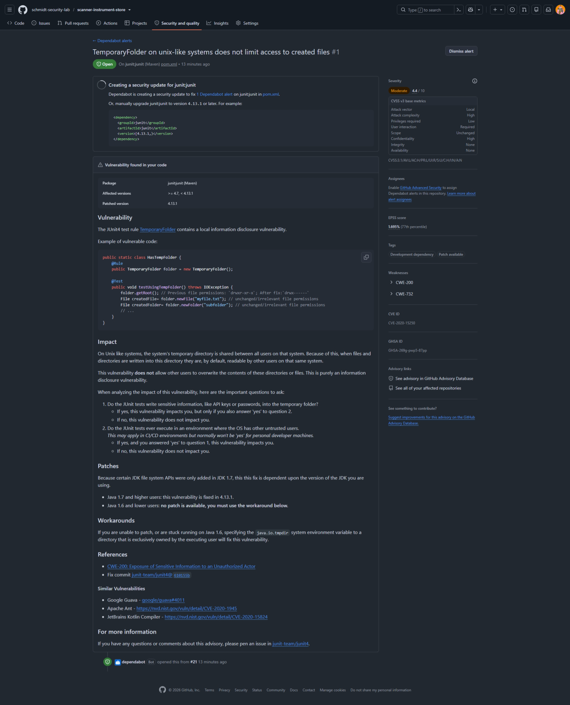
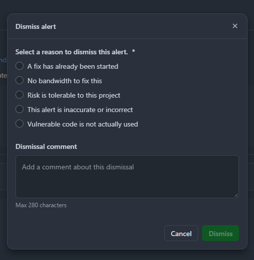

GITHUB SECURITY  /  PULL REQUESTS

# Guia de Dependabot para usuários

Como analisar alertas e revisar atualizações no seu [Pull Request](https://docs.github.com/en/pull-requests/get-started/about-pull-requests) (PR)

Use este guia se você cria, revisa, aprova ou faz merge de PRs. Os [alertas do Dependabot](https://docs.github.com/en/code-security/concepts/supply-chain-security/dependabot-alerts) apontam dependências com vulnerabilidades conhecidas. Seu papel é entender o achado, revisar a correção e confirmar o resultado. A configuração das ferramentas e das regras fica com a equipe mantenedora ou de segurança.

## Do alerta à revisão da atualização

1. [Abra o alerta](https://docs.github.com/en/code-security/how-tos/manage-security-alerts/manage-dependabot-alerts/view-dependabot-alerts) em Security and quality > Dependabot > Vulnerabilities. Se não tiver acesso, peça ajuda à pessoa mantenedora.

1. Confira o pacote, o arquivo de dependências, a severidade e a versão corrigida. Leia a descrição antes de concluir o impacto.

1. Se houver [PR de atualização](https://docs.github.com/en/code-security/concepts/supply-chain-security/dependabot-pull-requests), abra-o e confira quais alertas ele propõe resolver. Pode haver uma correção única para mais de uma vulnerabilidade.

1. Revise as versões alteradas e os arquivos do PR. Consulte o responsável pelo código quando não souber avaliar a compatibilidade.

1. Confira os [Checks](https://docs.github.com/en/pull-requests/reference/status-checks) e a [revisão humana](https://docs.github.com/en/pull-requests/collaborating-with-pull-requests/reviewing-changes-in-pull-requests/about-pull-request-reviews). Faça o merge apenas com as verificações e aprovações exigidas pelo repositório.

1. Após o merge na branch padrão e a atualização da análise, volte ao alerta e confirme que foi corrigido. Fechar o PR sem merge não atualiza a dependência.

> **Alertas e merge**
> O alerta não comprova exploração e, sozinho, não impõe bloqueio de merge. Um PR liberado ainda pode conter riscos. As regras do repositório continuam valendo; em caso de bloqueio, encaminhe a mensagem à pessoa mantenedora.

Figura 1. Lista de alertas de treinamento com pacote, severidade, escopo e arquivo afetado.

## Entenda os detalhes do alerta

No detalhe do [alerta](https://docs.github.com/en/code-security/how-tos/manage-security-alerts/manage-dependabot-alerts/view-dependabot-alerts), confira o pacote, a versão usada, o intervalo afetado e a versão corrigida, quando disponível. O [advisory](https://github.com/advisories/GHSA-269g-pwp5-87pp) explica o problema e suas condições. A severidade ajuda a priorizar; confirme o uso da dependência com quem conhece o serviço.

Figura 2. Detalhe histórico do alerta de JUnit com versões, impacto e orientação de correção.

> **Como ler este exemplo**
> A captura registra junit:junit no pom.xml, severidade Moderate, escopo Development e correção indicada em 4.13.1. Esses dados pertencem ao alerta mostrado; não definem qual versão seu projeto deve adotar hoje.

- [Development](https://docs.github.com/en/code-security/how-tos/manage-security-alerts/manage-dependabot-alerts/view-dependabot-alerts) indica uso em desenvolvimento, testes ou build. Não significa que o risco possa ser ignorado.

- Se não houver correção disponível ou a mudança trouxer incompatibilidades, registre a dúvida no PR e acione o responsável pelo código e a equipe de segurança.

## Revise o PR antes do merge

O Dependabot pode propor um [security update](https://docs.github.com/en/code-security/concepts/supply-chain-security/dependabot-pull-requests) quando encontra uma vulnerabilidade na branch padrão e consegue preparar uma correção. A abertura automática depende da configuração do repositório. A equipe também pode preparar a atualização manualmente.

1. Leia a descrição do PR. Identifique o pacote atualizado, a versão de origem, a versão de destino e os alertas associados.

1. Abra [Files changed](https://docs.github.com/en/pull-requests/collaborating-with-pull-requests/reviewing-changes-in-pull-requests/reviewing-proposed-changes-in-a-pull-request) para conferir as alterações. Verifique os arquivos de dependências e de versões travadas, quando existirem. Consulte as notas de versão e o histórico de mudanças vinculados ao PR.

1. Confira a execução de compilação e testes do [GitHub Actions](https://docs.github.com/en/actions/about-github-actions/understanding-github-actions). Se algo falhar, abra o resumo e peça avaliação à equipe responsável antes de prosseguir.

1. Aguarde as [aprovações exigidas](https://docs.github.com/en/pull-requests/collaborating-with-pull-requests/reviewing-changes-in-pull-requests/about-pull-request-reviews). Ser um PR aberto pelo Dependabot não dispensa revisão nem as regras da branch. O bot não substitui o revisor da equipe.

1. Quando a mudança estiver revisada e os requisitos forem atendidos, use o fluxo de [merge](https://docs.github.com/en/pull-requests/collaborating-with-pull-requests/incorporating-changes-from-a-pull-request/merging-a-pull-request) adotado pelo projeto. Se não tiver permissão, peça a uma pessoa autorizada.

1. Reabra a página do alerta depois da atualização da análise. Confira o histórico para distinguir correção de dispensa. Se continuar aberto, compartilhe o link com o responsável pelo código.

> **Check verde não é uma garantia de segurança**
> Um resultado de compilação ou testes não substitui a avaliação do alerta. Skipped indica que aquela verificação foi pulada; não comprova que ela analisou a atualização.

## Situações comuns

| O que aparece | Como agir |
| --- | --- |
| Dois alertas e um PR | Confira os alertas vinculados. A atualização de um único pacote pode corrigir mais de uma vulnerabilidade. |
| Review security update | O botão leva ao PR de correção existente. Ele não representa uma aprovação. |
| Sem PR automático | Leia a versão corrigida e encaminhe a atualização ao responsável. Não é necessário configurar o GitHub para fazer essa triagem. |
| Review required ou check obrigatório | Leia a exigência no PR e peça a revisão ou o ajuste ao responsável. Não dispense o alerta como tentativa de liberar o merge. |

## Checklist antes de aprovar ou fazer merge

☐  Entendi qual dependência muda e quais alertas a atualização pretende corrigir.

☐  As alterações e possíveis incompatibilidades foram avaliadas pela equipe responsável.

☐  Compilação e testes foram conferidos; verificações puladas foram identificadas.

☐  As aprovações e os demais requisitos do repositório foram atendidos.

☐  Está combinado quem confirmará a correção do alerta após o merge.

## Use Dismiss após a análise

[Dismiss](https://docs.github.com/en/code-security/how-tos/manage-security-alerts/manage-dependabot-alerts/view-dependabot-alerts) dispensa o alerta sem atualizar a dependência. Use quando houver uma decisão fundamentada e autorizada para não aplicar a correção naquele momento. Se você não puder avaliar o risco, mantenha o alerta aberto e encaminhe-o à equipe responsável.

Figura 3. Escolha do motivo de dispensa e campo de comentário na tela de treinamento.

| Motivo exibido | Quando usar e o que registrar |
| --- | --- |
| A fix has already been started | Existe correção em andamento. Vincule o PR ou a tarefa e o responsável pelo acompanhamento. |
| No bandwidth to fix this | A equipe decidiu adiar por capacidade. Registre acompanhamento e reavaliação conforme a política. |
| Risk is tolerable to this project | O responsável autorizado aceitou o risco com base na análise. Registre contexto, mitigação e aprovação. |
| This alert is inaccurate or incorrect | Há evidência de que a indicação está incorreta. Registre como isso foi confirmado. |
| Vulnerable code is not actually used | A equipe verificou que a funcionalidade vulnerável não é utilizada no contexto relevante. Registre a evidência. |

A interface exige um motivo; o comentário é opcional no GitHub. Registre a justificativa conforme o processo da equipe. Se houver [aprovação delegada](https://docs.github.com/en/code-security/how-tos/manage-security-alerts/manage-dependabot-alerts/enable-delegated-alert-dismissal), envie a solicitação e aguarde a análise da pessoa autorizada.

> **Modelo de comentário**
> Analisado por [pessoa]. Motivo [motivo]. Evidência [verificação ou link]. Acompanhamento [tarefa e responsável]. Revisão [prazo, quando aplicável]. Não inclua senhas ou tokens.

Em [Closed](https://docs.github.com/en/code-security/how-tos/manage-security-alerts/manage-dependabot-alerts/view-dependabot-alerts), confira o motivo e o histórico: o alerta pode estar corrigido ou dispensado. Alertas dispensados e ainda não corrigidos podem ser reabertos.

## Referências para sua consulta

As palavras destacadas ao longo do guia são clicáveis e levam à documentação oficial. Use as referências abaixo para rever o fluxo sem alterar configurações do GitHub.

[Dependabot alerts](https://docs.github.com/en/code-security/concepts/supply-chain-security/dependabot-alerts) — Como os alertas são gerados, o que mostram e suas limitações.

[Visualizar e atualizar alertas](https://docs.github.com/en/code-security/how-tos/manage-security-alerts/manage-dependabot-alerts/view-dependabot-alerts) — Como abrir o alerta, corrigir, dispensar e consultar Closed.

[Dependabot pull requests](https://docs.github.com/en/code-security/concepts/supply-chain-security/dependabot-pull-requests) — Como funcionam os PRs de atualização de segurança e de versão.

[Files changed e revisão do diff](https://docs.github.com/en/pull-requests/collaborating-with-pull-requests/reviewing-changes-in-pull-requests/reviewing-proposed-changes-in-a-pull-request) — Como revisar as mudanças propostas antes de aprovar.

[Checks e status checks](https://docs.github.com/en/pull-requests/reference/status-checks) — Como interpretar os resultados exibidos no PR.

[Revisão e aprovação de PRs](https://docs.github.com/en/pull-requests/collaborating-with-pull-requests/reviewing-changes-in-pull-requests/about-pull-request-reviews) — Responsabilidades e estados da revisão humana.

[Merge de um PR](https://docs.github.com/en/pull-requests/collaborating-with-pull-requests/incorporating-changes-from-a-pull-request/merging-a-pull-request) — Etapas de mesclagem e requisitos do repositório.

[Dismiss delegado de alertas](https://docs.github.com/en/code-security/how-tos/manage-security-alerts/manage-dependabot-alerts/enable-delegated-alert-dismissal) — Como funciona a aprovação para dispensar um alerta.

[Advisory JUnit do exemplo](https://github.com/advisories/GHSA-269g-pwp5-87pp) — Referência do caso histórico mostrado nas capturas.

## Quando pedir ajuda

- Você não consegue abrir o alerta ou os detalhes de segurança vinculados ao PR: peça acesso à pessoa mantenedora.

- Você não sabe se a versão sugerida é compatível ou se a funcionalidade vulnerável é usada: peça avaliação ao responsável pelo código.

- O PR está bloqueado por revisão ou verificação obrigatória: compartilhe a mensagem com quem administra as regras.

- Não há versão corrigida ou há dúvida sobre Dismiss: encaminhe o alerta à equipe de segurança, com o contexto já levantado.

> **Responsabilidades**
> Autores e revisores analisam a mudança e seguem o fluxo de revisão e merge. A equipe mantenedora ou de segurança administra a habilitação das ferramentas, acesso aos alertas e políticas aplicáveis.

Capturas de treinamento; interface e permissões variam conforme o repositório. Documentação oficial consultada em 15 de outubro de 2026.
