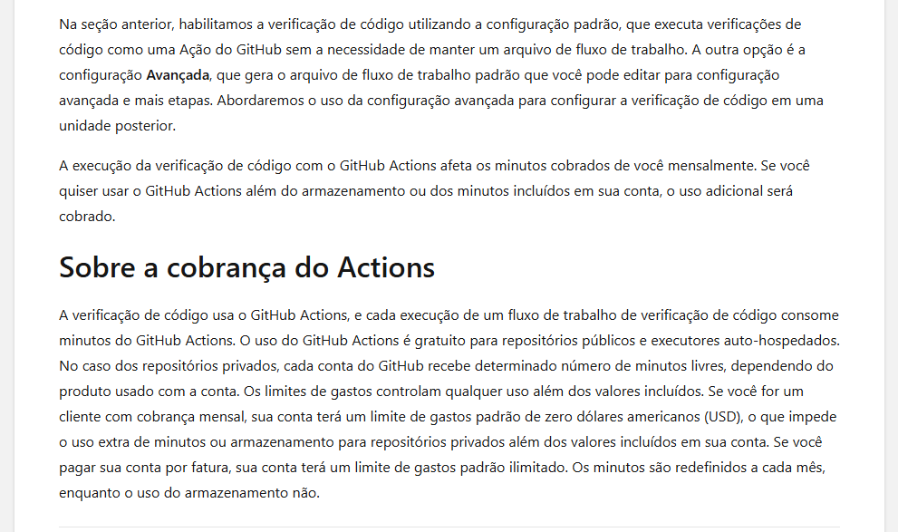

# Guia de PRs: Actions e Code Scanning

**Público:** pessoas que criam, revisam ou atualizam pull requests  
**Objetivo:** interpretar os checks de compilação e de segurança antes da revisão.

## O que acontece quando um PR é aberto

O workflow de build compila o projeto e executa seus testes. O CodeQL está configurado no **Default setup** do GitHub e publica os resultados do Code Scanning. Um workflow separado, **Code Scanning metrics**, prepara um arquivo baixável com um retrato dos alertas e das análises que a API do GitHub registrou. Em Default setup, o GitHub administra as análises; a rotina de métricas não configura nem inicia o CodeQL.

O material do GitHub abaixo compara a configuração gerenciada pelo GitHub (Default setup) com Advanced setup, que cria um workflow editável. É uma explicação geral do produto, não uma captura do código do PR.

Depois que a mantenedora aprovar e mesclar o workflow, ele gerará snapshots em pushes para `main` e diariamente ao meio-dia de Brasília. Ele não executa automaticamente em cada PR. Para um PR específico, a mantenedora pode iniciar **Actions > Code Scanning metrics > Run workflow** na branch `main` e informar o número do PR; o script consulta os dados do PR pela API sem executar o código proposto. Esse horário diário agenda o relatório, não uma análise CodeQL. A frequência da análise CodeQL é administrada pelo Default setup nas configurações do repositório.

## Relatório de métricas de uma execução

O workflow também gera um relatório baixável com o estado dos alertas e as análises que a API do GitHub registrou para o branch ou PR daquela execução. Para obter:

1. Depois que a mantenedora aprovar e mesclar a alteração, abra **Actions** no repositório.
2. Entre na execução **Code Scanning metrics** relacionada ao push para `main`, à agenda diária ou à execução manual solicitada para o PR.
3. Na página de resumo, baixe o artifact `code-scanning-metrics-...` na seção **Artifacts**.
4. Extraia o ZIP. `alerts-summary.csv` resume alertas abertos, dispensados e corrigidos por severidade. `dismissal-reasons.csv` resume os motivos dos alertas atualmente dispensados. `analysis-configurations.csv` lista categoria, ferramenta, horário, commit, quantidade de resultados, regras executadas e se aquela categoria corresponde ao commit da execução. `snapshot.json` reúne esses dados e o contexto da execução, incluindo `analysis.matched_current_execution`.

Os relatórios não mostram quem dispensou alertas, comentários, caminhos de arquivos nem detalhes individuais. A contagem de dismiss representa alertas que estão dispensados naquele momento do snapshot, não o total de ações de dismiss já realizadas. Compare snapshots de execuções diferentes para acompanhar a evolução. As categorias mostram as análises registradas, mas a API usada não informa quantos arquivos-fonte foram examinados. Em execuções de push, a rotina aguarda até dez minutos pela análise correspondente; em uma execução manual de PR, usa o número informado para consultar a análise do PR. Se `matched_current_execution` for `false`, as análises listadas são apenas as mais recentes disponíveis. O snapshot diário registra o estado atual e pode listar uma análise CodeQL anterior àquele dia. Os arquivos expiram em até 90 dias; baixe os que precisar guardar.

Uma análise CodeQL concluída não garante que não há alertas. Confira também o resultado agregado em **Security > Code scanning** e leia os detalhes do alerta antes de corrigir ou pedir revisão. O snapshot não contém o resultado interno do job CodeQL gerenciado; se `matched_current_execution` for `false`, confira a execução CodeQL em **Actions** e trate as categorias listadas como análises anteriores.

## Como interpretar os resultados

| Resultado | O que informa | Próximo passo |
|---|---|---|
| Build/teste aprovado | Compilação e testes configurados terminaram com sucesso. | Confira também a análise de segurança e a revisão. |
| Job de análise CodeQL aprovado | O scanner foi executado para aquela linguagem. | Abra o resultado agregado de Code Scanning; um job concluído pode ter encontrado alertas. |
| Alerta em Code Scanning | Uma regra identificou um fluxo ou padrão que merece investigação. | Leia a regra, severidade, arquivo, linha, origem e destino do fluxo. |
| Check agregado vermelho | Há um resultado que falhou a condição do check, como um novo alerta. | Corrija e envie um commit atualizado; confirme que a nova análise refletiu a correção. |

Um check vermelho não bloqueia merge por si só. A administração precisa tornar esse check obrigatório em regras de proteção da branch. Mesmo quando o GitHub permite mesclar, a pessoa autora deve corrigir o problema ou seguir o processo de exceção da organização.

## O que fazer quando o alerta aponta uma vulnerabilidade

1. Abra o alerta a partir do PR ou de **Security > Code scanning**.
2. Leia a regra e a explicação do fluxo. Confirme qual dado é controlado por entrada externa e onde ele chega a uma operação sensível.
3. Corrija a causa no código e acrescente ou ajuste testes quando fizer sentido.
4. Envie um commit para a mesma branch do PR. O build, o CodeQL conforme o Default setup e o workflow de métricas serão executados conforme seus próprios gatilhos.
5. Confirme que o alerta foi atualizado ou fechado e peça revisão.

Não descarte um alerta apenas para deixar o check verde. Use dismiss somente quando a análise confirmar que é falso positivo ou que existe uma justificativa aceita pela política da organização.

### Exemplo didático de resultado

No PR usado para o exercício, os jobs que executaram a análise CodeQL terminaram com sucesso, mas o resultado agregado encontrou uma vulnerabilidade High de SQL Injection e apontou o trecho de código. Isso mostra a diferença entre “o scanner conseguiu rodar” e “o scanner não encontrou problemas”. O alerta pode deixar o check de Code Scanning vermelho mesmo quando o build e os jobs de análise terminaram.

Evidências para consulta: [execução do workflow](https://github.com/aeroschmidt/scanner-loja-instrumentos/actions/runs/38105323924) e [resultado de Code Scanning no pull request](https://github.com/aeroschmidt/scanner-loja-instrumentos/pull/10/checks?check_run_id=114369610380). O PR continua sujeito à revisão da mantenedora; o check só bloqueia merge se for obrigatório nas regras da branch.

## Revisão e merge

A pessoa autora responde aos comentários e checks. A mantenedora revisa e aprova o pull request conforme as regras do repositório. Não presuma que um check verde equivale a aprovação, nem que um check vermelho sempre impede merge: são controles separados.

## Referências

- [Tipos de configuração do Code Scanning](https://docs.github.com/en/code-security/concepts/code-scanning/setup-types)
- [Configuração avançada do Code Scanning](https://docs.github.com/en/code-security/how-tos/find-and-fix-code-vulnerabilities/configure-code-scanning/configuring-advanced-setup-for-code-scanning)
- [Triagem de alertas em pull requests](https://docs.github.com/en/code-security/how-tos/manage-security-alerts/manage-code-scanning-alerts/triage-alerts-in-pull-requests)
