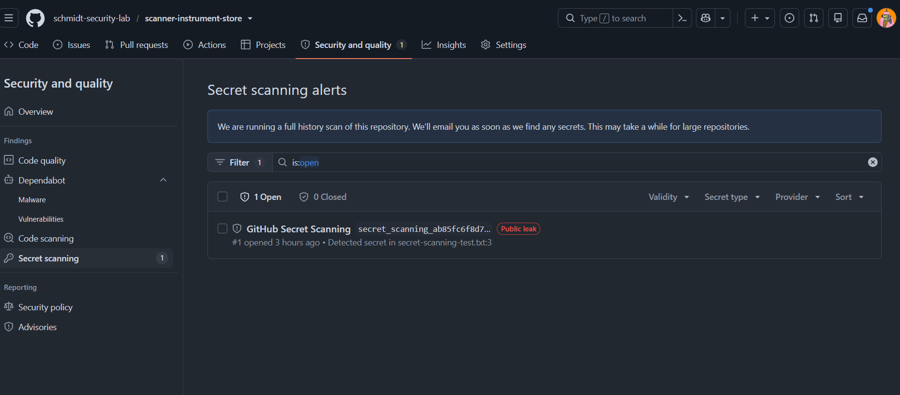
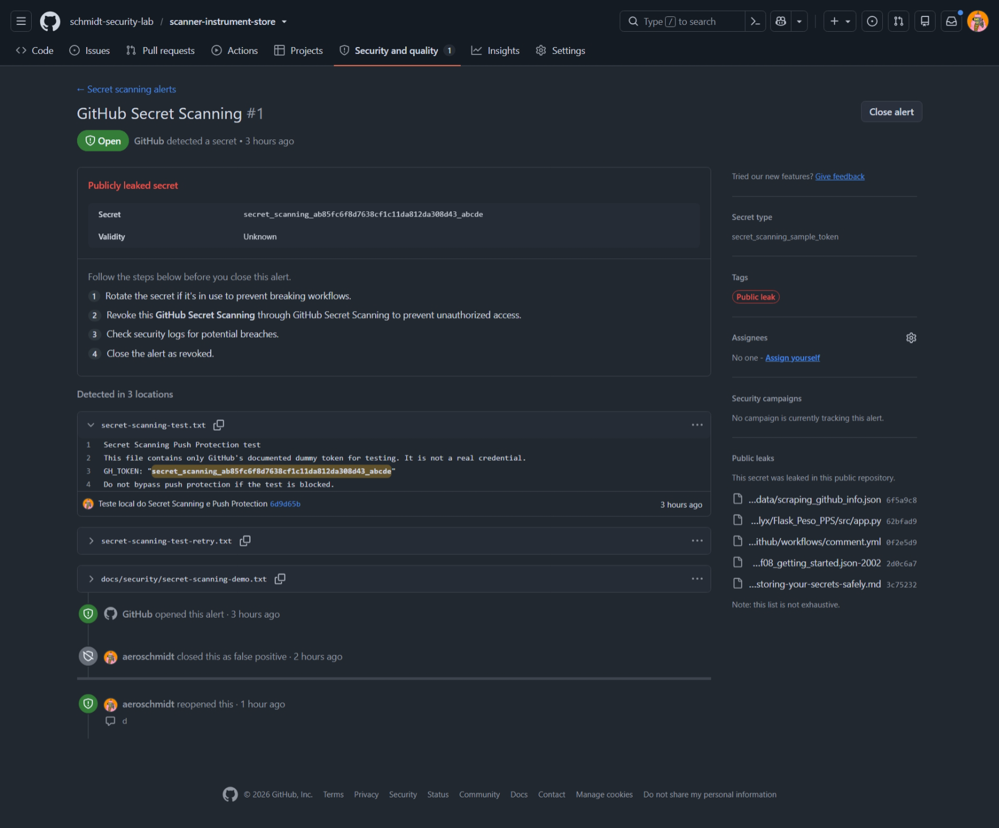
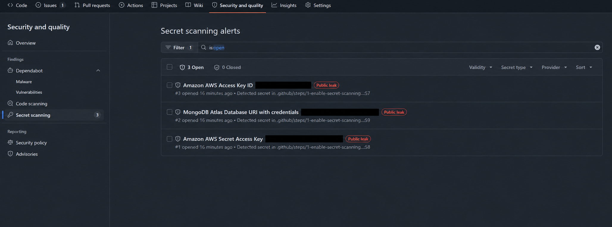
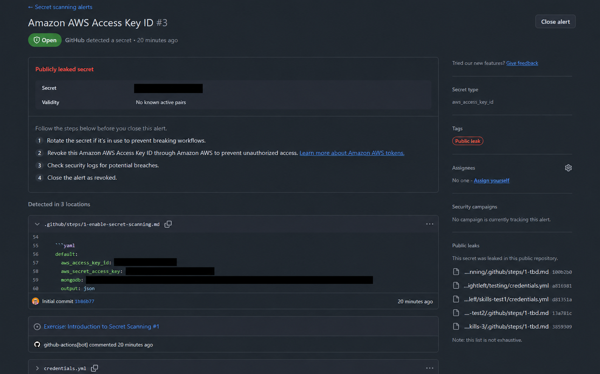
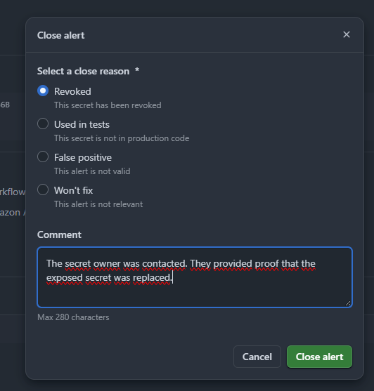

GITHUB SECURITY  /  PULL REQUESTS

# Guia de Secret Scanning para usuários

Como consultar alertas e tratar credenciais expostas no seu repositório

Use este guia se você cria, revisa ou faz merge de Pull Requests. O [Secret Scanning](https://docs.github.com/en/code-security/how-tos/manage-security-alerts/manage-secret-scanning-alerts/viewing-alerts) ajuda a identificar senhas, tokens e outras credenciais expostas. Ao receber um alerta, identifique o responsável pela credencial, acompanhe o tratamento e registre o resultado.

## Ao receber um alerta

1. Abra [Security and quality > Secret scanning](https://docs.github.com/en/code-security/how-tos/manage-security-alerts/manage-secret-scanning-alerts/viewing-alerts) no repositório e selecione o alerta. Se não tiver acesso, peça ajuda à pessoa mantenedora.

1. Confira tipo de segredo, validade, arquivo, linha e todas as localizações. Compartilhe o link do alerta com o responsável, sem copiar o valor da credencial.

1. Considere uma credencial real enviada ao repositório como comprometida. Acione seu titular ou a equipe responsável para revogação e substituição.

1. Corrija o arquivo para usar o mecanismo de segredos adotado pelo projeto. Combine a revisão e o merge com a equipe; uma alteração no código não revoga a credencial.

1. Confirme o tratamento e escolha o motivo de fechamento correspondente. Registre evidências e aguarde aprovação, se o processo exigir.

> **Seu papel no fluxo**
> Autores e revisores ajudam a identificar a exposição, corrigir o conteúdo e acompanhar o tratamento. Configurações da organização, permissões, regras de merge e autorizações de bypass ficam com a equipe mantenedora ou de segurança.

Figura 1. Lista de alertas de treinamento em Secret scanning. O aviso azul mostra uma análise do histórico ainda em andamento.

## Leia o alerta e suas localizações

No [detalhe do alerta](https://docs.github.com/en/code-security/how-tos/manage-security-alerts/manage-secret-scanning-alerts/viewing-alerts), abra cada localização detectada. Um segredo pode aparecer em mais de um arquivo ou commit. O histórico do alerta mostra ações de fechamento e reabertura; essas ações não alteram os commits.

Figura 2. Detalhes do alerta com valor fictício do tutorial, localizações e histórico. A captura não representa uma credencial operacional.

| Campo na tela | Como interpretar |
| --- | --- |
| Open e Closed | Indicam o estado do alerta. Para entender o tratamento, confira também o motivo e a timeline. |
| Secret type e Provider | Identificam o formato detectado e o serviço relacionado; ajudam a encontrar o responsável. |
| Validity | Informa a verificação disponível para o tipo de segredo. Unknown não comprova que o valor seja seguro. |
| Detected in locations | Lista as ocorrências detectadas. Confira arquivo, linha e commit de cada uma. |
| Public leak | Indica ocorrência pública encontrada pelo GitHub; não comprova uso indevido por terceiros. |

Use a [avaliação de alertas](https://docs.github.com/en/code-security/tutorials/remediate-leaked-secrets/evaluating-alerts) para interpretar validade e rótulos. Os campos disponíveis dependem do tipo de segredo e dos recursos habilitados.

## Reconheça diferentes tipos de segredo

As capturas mostram exemplos de treinamento de AWS e MongoDB. Os valores foram ocultados para que o manual possa ser compartilhado sem reproduzir credenciais.

Figura 3. Lista com tipos de segredo de AWS e MongoDB. Valores ocultados na imagem para distribuição.

Figura 4. Detalhe do alerta AWS e localizações. Os valores no painel e no código foram ocultados.

> **Confirme a situação no provedor**
> No known active pairs é o rótulo mostrado no exemplo. Ele não é uma evidência de revogação nem de ausência de uso indevido. O responsável pela credencial precisa confirmar o tratamento no serviço correspondente.

## Trate a credencial antes de fechar o alerta

Uma [credencial exposta](https://docs.github.com/en/code-security/how-tos/manage-security-alerts/manage-secret-scanning-alerts/resolving-alerts) precisa ser tratada no serviço que concede o acesso. Se você apenas revisa ou faz merge, acione o titular da credencial e acompanhe a confirmação das ações. Não crie ou revogue credenciais de terceiros sem a autorização aplicável.

## Token de acesso pessoal do GitHub

1. Identifique o titular e encaminhe o alerta. O responsável deve revogar ou excluir o [token comprometido](https://docs.github.com/en/authentication/keeping-your-account-and-data-secure/managing-your-personal-access-tokens).

1. Se o acesso continuar necessário, o titular cria uma nova credencial conforme as permissões e a política da equipe.

1. A equipe responsável atualiza os serviços que usavam o token anterior e confirma que o valor exposto não concede mais acesso.

## Credenciais de outros serviços

1. Identifique o serviço, o titular e os usos da credencial; validade desconhecida exige investigação.

1. Acione o responsável para gerar a substituição e atualizar os serviços, quando necessário.

1. Confirme a revogação ou invalidação da credencial antiga no provedor. A ordem de contenção e rotação segue o procedimento de incidente da equipe.

1. Solicite a análise de registros de segurança para verificar eventual uso não autorizado e registre o resultado no chamado.

## Corrija também o conteúdo enviado

Remova o valor do código e utilize o [mecanismo de segredos](https://docs.github.com/en/code-security/reference/secret-security/secret-types) aprovado pela equipe. Quando aplicável, [secrets do GitHub Actions](https://docs.github.com/en/actions/how-tos/write-workflows/choose-what-workflows-do/use-secrets) permitem usar credenciais sem gravar seu valor no arquivo do workflow. Cadastrar um secret não torna aceitável manter a mesma credencial escrita no código.

> **Arquivo atual e histórico**
> Apagar a linha, fechar o PR ou excluir uma branch não revoga a credencial. O histórico Git pode manter o conteúdo antigo. A limpeza do histórico exige coordenação da pessoa mantenedora e não substitui a revogação.

Se for necessária a [remoção de dados do histórico](https://docs.github.com/en/authentication/keeping-your-account-and-data-secure/removing-sensitive-data-from-a-repository), encaminhe à pessoa mantenedora. Depois da correção, confira o diff e siga a revisão e as aprovações exigidas pelo repositório.

## Se aparecer um bloqueio de envio

O [Push Protection](https://docs.github.com/en/code-security/concepts/secret-security/push-protection) atua no envio ao GitHub. Um commit local pode existir mesmo quando o push foi rejeitado. Leia a mensagem, corrija o conteúdo e siga o processo de revisão autorizado. A configuração desse bloqueio não faz parte das tarefas de revisão descritas neste guia.

## Escolha o motivo de fechamento

Depois do tratamento ou da análise fundamentada, abra [Close alert / Close as](https://docs.github.com/en/code-security/how-tos/manage-security-alerts/manage-secret-scanning-alerts/resolving-alerts) e escolha o motivo. Se não tiver permissão ou a interface pedir aprovação, encaminhe a solicitação à pessoa autorizada.

Figura 5. Motivos de fechamento e campo Comment. A captura mostra limite de 280 caracteres.

| Motivo e finalidade | Quando usar e o que confirmar |
| --- | --- |
| Revoked Credencial revogada | A credencial real foi invalidada no provedor. Registre responsável e evidência. Substituir a chave ou apagar o código não basta se a antiga continua ativa. |
| Used in tests Valor de teste | A análise confirmou um valor fictício ou de treinamento, sem acesso real. Uma credencial funcional usada em testes também deve ser tratada se exposta. |
| False positive Detecção incorreta | A sequência detectada não é uma credencial. Registre o que é o dado e como isso foi confirmado. Unknown ou remoção do arquivo não demonstram falso positivo. |
| Won’t fix Exceção autorizada | Há decisão justificada de não corrigir, com aprovação conforme a política. Registre risco, responsável, mitigação e revisão. O motivo não elimina a exposição. |

O comentário pode ser opcional na interface. Neste guia, registre sempre a justificativa e a referência das evidências, sem incluir a credencial. Se houver [aprovação delegada](https://docs.github.com/en/code-security/concepts/security-at-scale/delegated-alert-dismissal), aguarde a decisão; não escolha outro motivo apenas para encerrar mais rápido.

> **Fechamento registra a decisão**
> Escolher Revoked não revoga a credencial no provedor. O comentário deve registrar o que foi confirmado. Se a investigação ainda não sustenta o motivo, mantenha o alerta aberto e acione o responsável.

## Registre o resultado e confirme o encerramento

Use os exemplos abaixo apenas quando os fatos estiverem confirmados. Adapte responsável, evidências e acompanhamento. Se os detalhes não couberem no comentário, mantenha-os no chamado e informe sua referência.

> **Revoked**
> Credencial antiga revogada no provedor em [data]. Serviços migrados para a nova credencial. Responsável: [equipe]. Evidências: [chamado].

> **Used in tests**
> Valor fictício de treinamento, sem acesso real. Origem e finalidade do teste confirmadas por [responsável]. Evidências: [chamado].

> **False positive**
> A sequência é [tipo de dado], sem função de autenticação. [Responsável] confirmou a detecção incorreta. Evidências: [chamado].

> **Won’t fix**
> Exceção aprovada por [responsável]: [justificativa e impacto]. Mitigação: [controle]. Revisar em [data]. Decisão e evidências: [chamado].

## Checklist de tratamento

☐  Tipo de segredo, responsável e localizações foram identificados.

☐  O responsável confirmou a revogação e a atualização dos serviços, quando aplicáveis.

☐  O código foi corrigido e a revisão do PR seguiu o processo da equipe.

☐  O motivo de fechamento corresponde às evidências e tem a aprovação exigida.

☐  A timeline e o estado Closed foram conferidos; o acompanhamento ficou registrado.

## Dúvidas frequentes

- Fechei o PR e o alerta continua. Isso pode acontecer: [remover o conteúdo não fecha automaticamente o alerta](https://docs.github.com/en/code-security/how-tos/manage-security-alerts/manage-secret-scanning-alerts/resolving-alerts). Trate a credencial e registre o encerramento adequado.

- O PR passou sem avisos. Isso não comprova ausência de segredos. A consulta principal fica na área de segurança; [bloqueios de merge](https://docs.github.com/en/code-security/how-tos/secure-your-secrets/prevent-future-leaks/block-merges-with-secrets) dependem das regras aplicáveis.

- A lista mostra análise do histórico em andamento ou falha. Não conclua que todo o histórico está livre de segredos; informe a pessoa mantenedora e acompanhe a conclusão.

## Referências oficiais

[Consultar e filtrar alertas](https://docs.github.com/en/code-security/how-tos/manage-security-alerts/manage-secret-scanning-alerts/viewing-alerts)

[Avaliar validade e rótulos](https://docs.github.com/en/code-security/tutorials/remediate-leaked-secrets/evaluating-alerts)

[Tratar e encerrar alertas](https://docs.github.com/en/code-security/how-tos/manage-security-alerts/manage-secret-scanning-alerts/resolving-alerts)

[Gerenciar tokens pessoais](https://docs.github.com/en/authentication/keeping-your-account-and-data-secure/managing-your-personal-access-tokens)

[Entender o Push Protection](https://docs.github.com/en/code-security/concepts/secret-security/push-protection)

[Tipos de segredos no GitHub](https://docs.github.com/en/code-security/reference/secret-security/secret-types)

Capturas de treinamento; interface e permissões podem variar. Valores de credenciais nas imagens de AWS e MongoDB foram ocultados por edição. Documentação oficial consultada em 15 de outubro de 2026.
