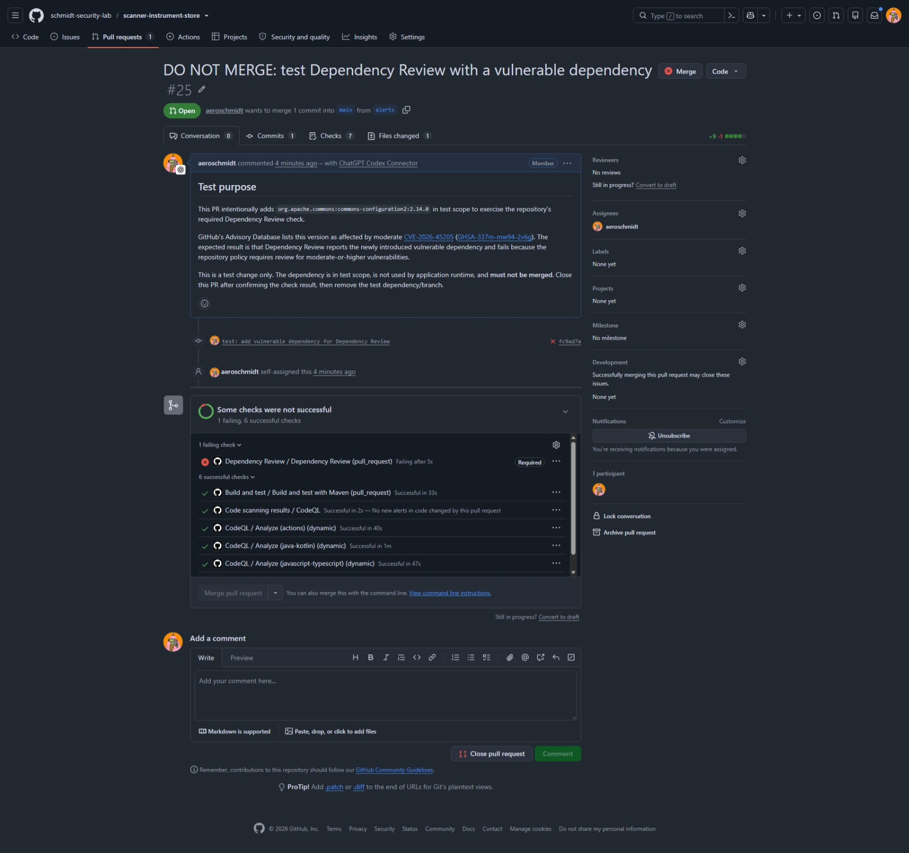
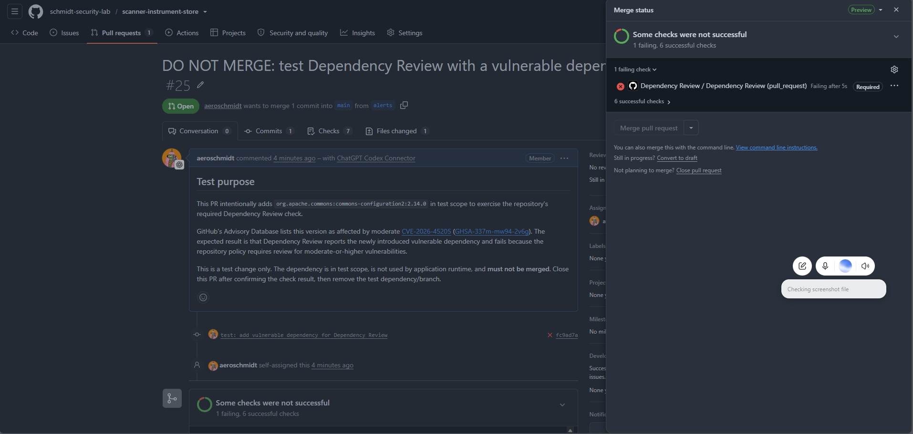

# Dependency Review test evidence

This folder preserves evidence from a controlled test of the repository's required Dependency Review check for future reference.

## Test record

- Date: 2026-10-14
- Repository: [scanner-instrument-store](https://github.com/schmidt-security-lab/scanner-instrument-store)
- Test pull request: [DO NOT MERGE: test Dependency Review with a vulnerable dependency](https://github.com/schmidt-security-lab/scanner-instrument-store/pull/25)
- Workflow run: [Dependency Review check run](https://github.com/schmidt-security-lab/scanner-instrument-store/actions/runs/38647647489)
- Advisory: [GHSA-337m-mw94-2v6g](https://github.com/advisories/GHSA-337m-mw94-2v6g)

## Observed result

The pull request intentionally adds `org.apache.commons:commons-configuration2:2.14.0` in test scope. The required Dependency Review check failed after detecting one moderate-severity vulnerable package. The Maven build and test check passed, and CodeQL completed with no new alerts in code changed by this pull request.

### Pull request and check status

### Merge status panel

## Scope and handling

This demonstrates that Dependency Review can block a pull request that introduces a vulnerable dependency. It does not mean that a pre-existing Dependabot alert on the default branch is automatically blocked by this check.

**This is a test-only change. Do not merge the test pull request.** After the check result has been reviewed, close the test pull request and remove its test-only dependency and branch. Keep these screenshots and this record only as historical evidence.
